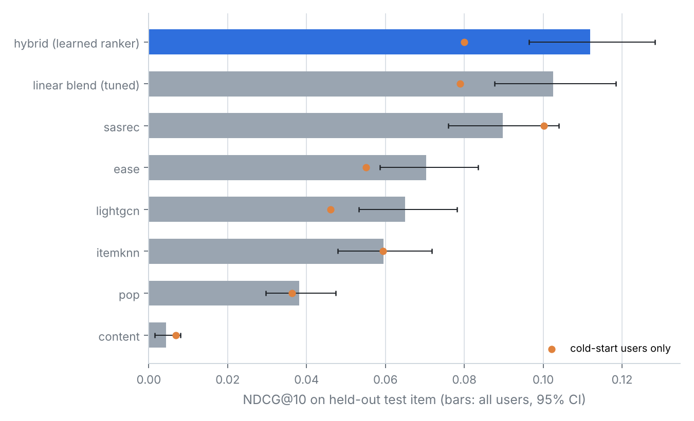
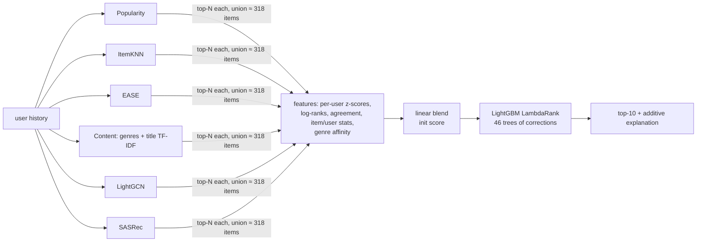
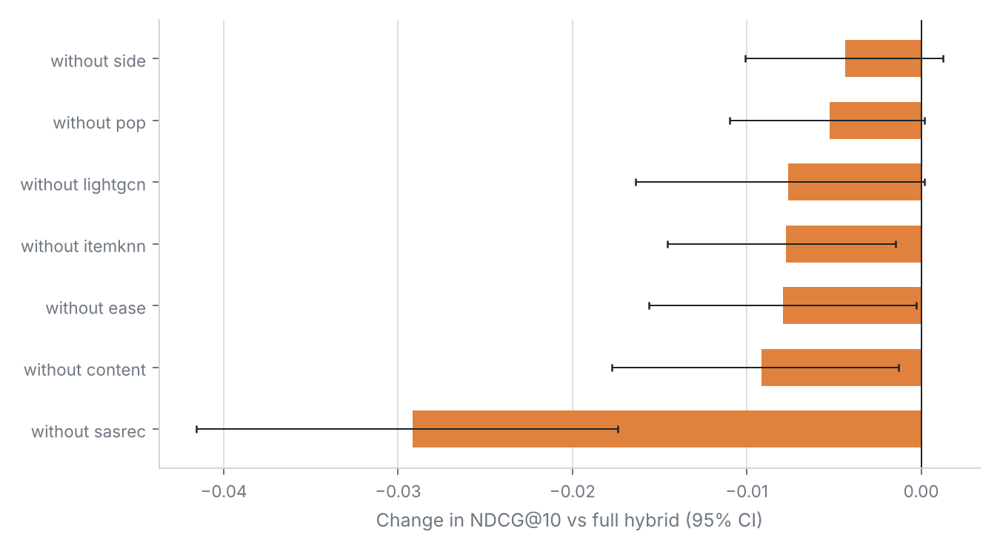
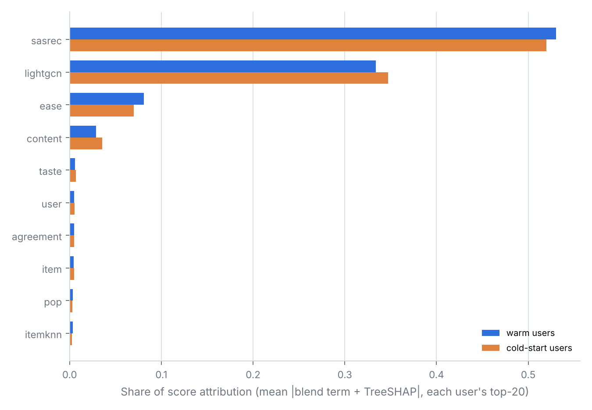

# cascade-rec: a multi-stage hybrid recommender, measured honestly


Six retrievers (popularity, item-kNN, EASE, a content model, LightGCN, SASRec) generate
candidates. A LightGBM LambdaRank model re-ranks them, starting from a tuned linear blend.
Every recommendation comes with an exact, additive explanation.

That architecture is common. What this repo really focuses on is the evaluation: no
test-set tuning, full-catalog ranking, confidence intervals, ablations, and a cold-start
analysis. It also reports where the system doesn't work.

On MovieLens-100K, with leave-last-out and full ranking over 1,682 items:

| Model | NDCG@10 [95% CI] | Recall@10 | NDCG@10, cold-start users |
|---|---|---|---|
| Popularity (recency-weighted) | 0.038 [0.030, 0.047] | 0.082 | 0.036 |
| ItemKNN | 0.060 [0.048, 0.072] | 0.106 | 0.059 |
| LightGCN (graph) | 0.065 [0.053, 0.078] | 0.127 | 0.046 |
| EASE (linear autoencoder) | 0.070 [0.059, 0.084] | 0.139 | 0.055 |
| SASRec (Transformer) | 0.090 [0.076, 0.104] | 0.165 | **0.100** |
| Linear blend, weights tuned on validation | 0.103 [0.088, 0.118] | 0.185 | 0.079 |
| **Hybrid: blend + boosted corrections** | **0.112 [0.096, 0.128]** | **0.207** | 0.080 |

The hybrid beats every single model, including the tuned blend: +0.009 NDCG@10, 95% CI
[+0.002, +0.016], from a paired bootstrap over users. It **does not** beat SASRec alone on
cold-start users. That result is discussed below because it's the most interesting one here.



**Contents:** [Quick start](#quick-start) · [Architecture](#architecture) ·
[Evaluation protocol](#evaluation-protocol) · [Findings](#findings) ·
[What went wrong](#what-went-wrong-along-the-way) · [HNSW at scale](#retrieval-at-scale-hnsw) ·
[Not built](#deliberately-not-built) · [Limitations](#limitations) · [Project layout](#project-layout)

## Quick start

```bash
git clone https://github.com/<your-username>/cascade-rec.git
cd cascade-rec
python3 -m venv .venv && source .venv/bin/activate
pip install -r requirements.txt

# MovieLens-100K (its license doesn't allow redistribution, so it isn't in the repo)
curl -O https://files.grouplens.org/datasets/movielens/ml-100k.zip
unzip ml-100k.zip -d data && rm ml-100k.zip

python -m pytest -q                      # 15 tests: leakage, metrics, models, end-to-end
python scripts/recommend.py --user 1     # explained recommendations from the saved results
python scripts/run_experiment.py         # full experiment, rewrites results/
```

> **macOS:** LightGBM needs the OpenMP runtime, which Apple's compiler doesn't include.
> If you see `Library not loaded: @rpath/libomp.dylib`, run `brew install libomp`.

The first full run trains every model from scratch: about 35 minutes on 2 CPU cores, and
faster on a recent laptop. It caches the retrieval stage in `results/cache.pkl`, so later
runs only redo ranking, ablations and reporting (a few minutes). Use `--rebuild` to force a
full refit, or `--quick` for a smoke run whose numbers aren't meaningful.

---

## Why this is a rewrite (v1 → v2)

The first version of this project had good instincts: it was hybrid, it handled cold-start,
and it measured coverage and novelty. But its numbers couldn't be trusted:

1. **The blend weights were chosen on the test set.** v1 tried several (α, β, γ) settings
   and reported the best one. That's test-set tuning, and it inflates every metric. In v2,
   nothing looks at the test item until one final evaluation.
2. **There was no validation split**, so there was nowhere legitimate to tune anything.
3. **No uncertainty was reported.** On about 1k test users, NDCG@10 has a 95% CI roughly
   ±0.015 wide. Many "improvements" in recsys papers are smaller than that.
4. **It was slow by construction.** A `NearestNeighbors` model was refit inside every
   per-user recommendation call.

## Architecture



**Retrieval (stage 1).** Each retriever covers something the others miss:

- **EASE** (Steck, 2019) is a closed-form item-item linear autoencoder: one matrix inverse,
  no epochs. Any fancier model has to beat this baseline first.
- **LightGCN** (He et al., 2020) passes collaborative signal over the user-item graph using
  feature-free graph convolution.
- **SASRec** (Kang & McAuley, 2018) uses causal self-attention over the order in which a user
  watched things. It's trained with full-softmax cross-entropy instead of the original
  one-negative BCE. Klenitskiy & Vasilev (2023) showed that change alone is worth more than
  most architecture tweaks. The Transformer is applied to interaction sequences, where it
  earns its keep, rather than to item text, where MovieLens has almost nothing to read.
- **Content** is the only retriever that works when an item has zero interactions.

The union of all candidate lists contains the held-out item for **85.4%** of users. That's
the ceiling for the ranker. SASRec on its own reaches 67.4% at N=150.

**Ranking (stage 2).** The ranker never trains from scratch. LightGBM starts from the
linear blend's score (`init_score`), and the trees learn only corrections. So the ranker
can't do worse than the blend unless the corrections overfit, and early stopping on a
temporal validation slice guards against that.

**Explanations.** The final score is exactly `Σ wᵣ·zᵣ + Σ TreeSHAP`, so attributions add
up to the score with no approximation. Grouping by source gives "how much SASRec
contributed", and so on. Raw attributions read the same for every item (SASRec and LightGCN
dominate), so the reasons shown are *contrastive*: the signals that lift this item more
than the user's other top-20. Each reason gets a concrete anchor where one exists.

```
$ python scripts/recommend.py --user 1
User 1  (271 known interactions)
 1. Titanic
      - follows on from what you've watched lately, especially Gattaca
      - matches genres you've been watching (Action, Drama)
      SHAP: sequence model (SASRec) +0.94, graph neighbours (LightGCN) +0.45, content match +0.06, ...
 2. English Patient, The
      - follows on from what you've watched lately, especially Kolya
      - often watched alongside things in your history
```

## Evaluation protocol

- **Split.** Chronological leave-last-out per user: `[history | val | test]`.
  - *Tune stage:* models see the history and are scored on val. EASE's λ, LightGCN's and
    SASRec's epochs (by early stopping), the blend weights, and the ranker's settings are
    all chosen here.
  - *Test stage:* everything is refit on history + val, with no access to any target, and
    scored once on test.
- **Ranker training data.** Ranker training uses three time slices (targets at offsets 1, 2
  and 3 from the end), each with its own freshly fit retrievers. That gives 2,829 queries
  instead of 943, and the ranker sees scores produced the same way they will be at test time.
- **Ranker validation is temporal.** It trains on the older slices and validates on the most
  recent one. A random user holdout within the same slices hides the score-scale shift
  between independently trained neural models. See "what went wrong" below.
- **Full-catalog ranking.** The test item is ranked against *every* unseen item, not 100
  sampled negatives. Sampled metrics can flip model orderings (Krichene & Rendle, 2020).
  Ties are broken pessimistically, so a constant-score model can't look good by luck.
- **Statistics.** 95% CIs come from 2,000 bootstrap resamples over users. Model comparisons
  use a *paired* bootstrap, so per-user difficulty cancels out.
- **Cold-start cohort.** MovieLens guarantees ≥20 ratings per user, so there are no natural
  cold users. 20% of users (189) are truncated to their last 7 interactions: 5 for history,
  then val, then test. Their test-time history is 6 items.

## Findings

**1. EASE, a single matrix inverse, beats LightGCN.** Val NDCG@10 is 0.086 vs 0.070, and
EASE fits in under a second instead of two minutes. This is consistent with the
"are we really making progress?" line of work (Dacrema et al., 2019). Strong simple
baselines should come first.

**2. Sequence order is the strongest single signal on this data.** SASRec is the best
single model. Dropping it costs the hybrid 0.029 NDCG@10, CI [−0.042, −0.017], which is
by far the largest ablation. Every other source adds a little: removing any one of them
costs 0.004–0.009. For itemknn, EASE and content the CI just excludes 0. For popularity,
LightGCN and the side features it doesn't.



**3. On cold-start users, SASRec alone beats every hybrid. The ranker doesn't learn to
defer to it.** SASRec scores 0.100 NDCG@10 on cold users vs 0.080 for the hybrid (paired
diff −0.020, CI [−0.052, +0.008]). The direction is consistent, though the interval is wide
with only 189 users. The reason is visible in the attributions: the ranker spreads weight
across sources almost identically for warm and cold users. It has `user__loghist` as a
feature but never builds a strong "short history → trust the sequence model" gate. Cold
users are only 20% of training queries, so there's little pressure to. It makes sense that
SASRec does well here: a sequence model only needs the last few items, while EASE and
LightGCN need enough history to locate the user. The obvious next experiments are a
segment-specific ranker and an explicit history-length gate on the blend weights.



**4. The content model is nearly useless on its own** (NDCG@10 0.004), but removing it
still costs the hybrid 0.009 (CI [−0.018, −0.001]). Genre and decade signals help *re-rank*
candidates the collaborative models already found, even though they can't find good
candidates themselves.

## What went wrong along the way

The first two versions of the ranker trained LambdaRank from scratch and validated on a
random 20% of users. On test they scored **0.0995 and 0.094 (the second after a
validation-chosen grid search), both below the tuned linear blend's 0.103.** In theory
it can represent the blend, so this needed explaining. The cause:
each training slice has its own independently trained SASRec and LightGCN, and their raw
score scales differ from model to model. Trees split on raw thresholds that don't transfer.
A random-user validation set sits inside the same slices, so it couldn't see the problem.

The fix was to validate temporally (hold out the most recent slice), start boosting from
the blend, and include `raw_scores` on/off in the selection grid. All 16 configurations
were then scored on validation only (`results/RESULTS.md` lists them). Validation picked
the blend-initialized ranker.

**This means the test set was looked at three times**: twice for the failed designs and
once for this one. The redesign was motivated by a diagnosis, not by searching on test, and the
selection itself used validation only. Still, the final hybrid-vs-blend margin should be
read with that in mind. A clean confirmation would rerun with a different seed and split,
or on ML-1M.

## Retrieval at scale (HNSW)

LightGCN and SASRec score with dot products, so top-N retrieval is a maximum-inner-product
search. At 1.7k items, brute force is instant. `src/hrec/ann.py` wraps an HNSW index for
catalogs where it isn't. `scripts/bench_ann.py` compares exact vs approximate search on
synthetic embedding-like vectors (clustered, intrinsic dimension 16, in 64-d), one
query on one core:

| items | ef | recall@100 vs exact | HNSW latency | exact latency | speedup |
|---|---|---|---|---|---|
| 100k | 100 | 0.997 | 0.07 ms | 0.97 ms | 13× |
| 300k | 100 | 0.995 | 0.11 ms | 2.69 ms | 24× |
| 300k | 400 | 0.9997 | 0.36 ms | 2.69 ms | 7.5× |

An earlier run on isotropic Gaussian noise got only 0.32 recall at 300k. Graph indexes depend
on the data having low intrinsic dimension, so it's worth benchmarking on your own embeddings
before trusting any ANN number.

## Deliberately not built

- **Bayesian neural networks for cold-start uncertainty.** These are expensive and
  notoriously hard to calibrate, and with 943 users there's nothing for them to be
  uncertain *about* that bootstrap CIs don't already show. The cold-start problem turned
  out to be about *gating*, not uncertainty (finding 3).
- **A deep CTR ranker.** With about 2.8k training queries, a deep model would mostly fit
  noise. GBDT rankers remain the standard choice at this stage, and they give exact SHAP
  values for free.
- **Transformer text embeddings.** MovieLens items have a title and a genre list, so there
  isn't enough text for a language model to add much. On Amazon data, with real
  descriptions, they'd be worth adding as another content retriever.

## Limitations

- ML-100K is small: 943 users. CIs are wide, and some ablation effects sit near the
  noise floor.
- One seed per neural model. Seed variance isn't included in the CIs.
- Leave-last-out lets the model see other users' interactions from after a user's test
  time (Ji et al., 2023, "A Critical Study on Data Leakage in Recommender System Offline
  Evaluation"). A global temporal split would be stricter.
- Cold-start is simulated by truncation, not observed.

## Other datasets

- **MovieLens-1M:** unzip [ML-1M](https://grouplens.org/datasets/movielens/1m/) into
  `data/ml-1m`, then run `python scripts/run_experiment.py --dataset ml-1m --out results/ml-1m`.
- **Amazon Reviews** (2018 or 2023 jsonl, optionally gzipped): put the files in `data/`, then run
  `python scripts/run_experiment.py --dataset amazon:<reviews.jsonl.gz>,<meta.jsonl.gz>`.
  The loader applies a 5-core filter, since raw Amazon data is extremely sparse.

Other scripts: `python scripts/bench_ann.py` runs the HNSW benchmark, and
`python scripts/recommend.py --random-cold` shows a random cold-start user.

## Project layout

```
src/hrec/
  data.py          loaders, chronological split, cold-start cohort, time slices
  metrics.py       full-ranking metrics, pessimistic ties, (paired) bootstrap
  retrievers/      classic.py (Pop, ItemKNN, EASE, Content) · neural.py (LightGCN, SASRec)
  features.py      candidate union + ranker features
  ranker.py        blend-initialised LambdaRank, temporal validation, linear blend
  explain.py       additive attributions -> contrastive, anchored reasons
  ann.py           HNSW retrieval
  pipeline.py      the experiment, step by step
  report.py        RESULTS.md + figures
scripts/           run_experiment.py · recommend.py · bench_ann.py
tests/             split leakage, metrics, retrievers, ranker additivity, end-to-end smoke
results/           RESULTS.md (every table), metrics.json, figures, saved explanations
```

`results/RESULTS.md` has the full tables: per-retriever candidate recall, all ablations,
the ranker selection grid, and warm/cold paired comparisons for every model.

## References

Steck, *Embarrassingly Shallow Autoencoders for Sparse Data*, WWW 2019 ·
He et al., *LightGCN*, SIGIR 2020 · Kang & McAuley, *Self-Attentive Sequential
Recommendation*, ICDM 2018 · Klenitskiy & Vasilev, *Turning Dross Into Gold Loss: is BERT4Rec
really better than SASRec?*, RecSys 2023 · Burges, *From RankNet to LambdaRank to
LambdaMART*, 2010 · Lundberg et al., *From local explanations to global understanding with
explainable AI for trees*, Nature MI 2020 · Krichene & Rendle, *On Sampled Metrics for Item
Recommendation*, KDD 2020 · Dacrema et al., *Are We Really Making Much Progress?*, RecSys 2019 ·
Ji et al., *A Critical Study on Data Leakage in Recommender System Offline Evaluation*, TOIS
2023 · Malkov & Yashunin, *HNSW*, TPAMI 2018.

## Author

Aarush Kampani, Computer Science at the University of Wisconsin–Madison.

MovieLens data © GroupLens Research, University of Minnesota. It is used under their
terms and isn't redistributed here.
